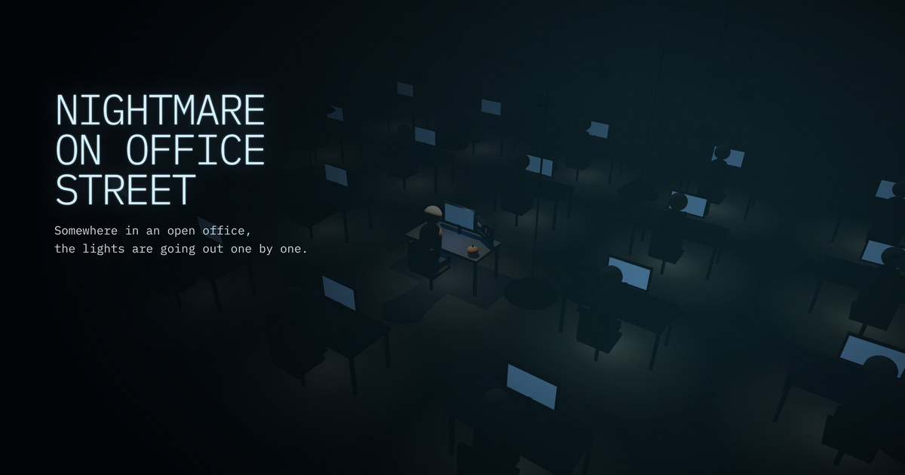

# Nightmare on Office Street

A small Halloween story about layoffs, AI hype and a guy who just wants a quiet life.
Built with Three.js for the [Three.js Journey](https://threejs-journey.com/) Halloween challenge.

**▶ Play: [nightmare-on-office-street.vercel.app](https://nightmare-on-office-street.vercel.app/)**



It's the night shift in an open office. One by one, your colleagues get fired: their lamps
flicker and go out, and they rise from their chairs as ghosts carrying a box of their things.
Notifications fly at you out of the dark. Survive until 06:00.

## How to play

- **Hold your monitor** to work. Performance drains on its own, so keep it up.
- **Click (or tap) notifications** before they reach you. Each one that lands adds stress.
- Make it to **06:00** without hitting zero performance or full stress.
- Pick a **role** on the start screen: Junior, Middle, Senior or Lead. The rules stay the same, the pace doesn't.
- There are **five endings**, and one of them is a secret.
- Not in the mood to play? **Look around** turns the office into a slow, living diorama you can explore.

| Key | Action |
|---|---|
| Hold / click | work, dismiss notifications |
| `M` | toggle sound |
| `Esc` | leave Look around mode |

## Highlights

- **One real light.** Only the hero's lamp is a real `SpotLight` with shadows. Every other desk fakes it
  with an unlit bulb mesh and an additive light pool on the floor, which keeps twenty lamps cheap on phones.
- **Forgiving hit testing.** Cards are tested in screen pixels with padding rather than with a raycast,
  and dismissed on press instead of release, so fast-moving targets are actually catchable on touch screens.
- **Procedural audio.** The hum, ventilation hiss, heartbeat, pings and the final chord are all generated
  with the Web Audio API. There are no audio files.
- **Canvas text everywhere.** Notifications, labels and both of the hero's monitors (a typing code editor and a
  job application counter) are drawn on canvas textures.
- **A level ladder from two presets.** Only Junior and Lead are tuned by hand; Middle and Senior are interpolated
  between them, so the difficulty step is always even.
- **Accessible where it counts.** Keyboard and screen reader users can start without holding, the handbook is a
  native `<dialog>`, and `prefers-reduced-motion` turns off flicker and long transitions.

## Run locally

```bash
npm install
npm run dev      # dev server
npm run build    # production build in dist/
npm run lint     # ESLint
```

Useful URL hashes:

- `#debug` loads a lil-gui panel for tuning fog, lights, pacing and levels, and has buttons to trigger each ending.
- `#tutorial` replays the first-run tutorial.

## Project structure

```
src/
  main.js        game loop, camera, input, story pacing, tutorial and endings
  office.js      floor, desks, colleagues and the hero's desk
  ghosts.js      ghosts of fired colleagues
  screens.js     the hero's two monitors
  content.js     all of the game's text: code files, notifications, endings
  levels.js      difficulty presets and interpolation
  sound.js       procedural audio
  canvasText.js  text → canvas texture helpers
  debug.js       lil-gui panel, loaded only with #debug
  storage.js     guarded localStorage helpers
  ui.js          DOM references
  utils.js       clock and small helpers
```

More on how the pieces fit together is in [docs/architecture.md](docs/architecture.md).

## Credits

Three.js, lil-gui and Vite. All models are built from Three.js primitives and all sound is generated in code,
so there are no third-party assets. See [CREDITS.md](CREDITS.md).
